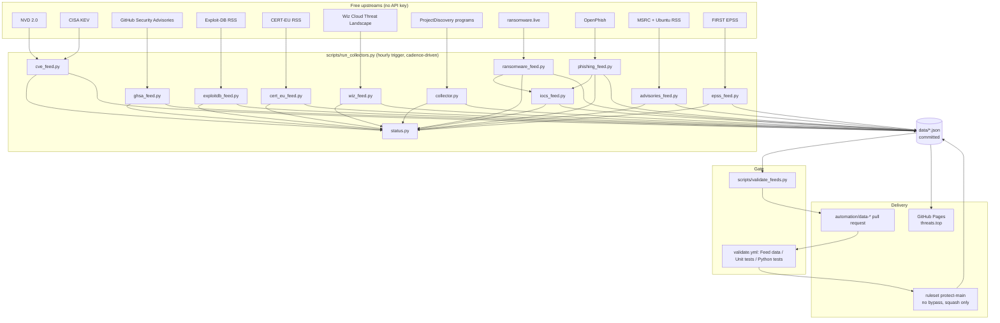

# threats-platform — Architecture & Operations

_Last reviewed: 2026-10-28 against `main` and the live `threats.top` deployment._

This document describes what is deployed and why. When a script, page, feed, or workflow changes materially, this file changes in the same pull request.

---

## 1. What this is

A static threat-intelligence publication. Free, official, no-key sources are collected by scheduled GitHub Actions, normalised into committed JSON, validated before publication, and served by GitHub Pages at `threats.top`.

There is no database server, no long-running backend, and no runtime dependency. The only compute outside GitHub Actions is a retired Cloudflare Worker that now fails closed; it holds no secrets and cannot write data.

Two properties are non-negotiable:

1. **No demo data.** Every published number comes from a live upstream. An empty or malformed feed is a failure, not a reason to render a placeholder.
2. **No direct path to `main`.** Automated and manual changes both arrive as pull requests that must pass the required checks.

---

## 2. High-level architecture



The important arrow is the loop: a collector never writes to production. It writes a candidate file, the validator inspects it against the previous committed version, and only a pull request that passes all three checks can update `main`, from which Pages deploys.

---

## 3. Repository layout

```
.github/
  workflows/
    update-data.yml       hourly collection → validate → automation PR
    validate.yml          pull-request gate: Feed data, Unit tests, Python tests
  dependabot.yml          SHA-pinned action updates
assets/
  app.css                 shared design system
  app.js                  esc(), time helpers, tabs, fetch helpers
  app.test.mjs            XSS and time-helper tests
data/                     committed JSON; this is the database
  cves.json               NVD window + KEV
  cves_headline.json      bounded homepage slice
  ghsa.json               GitHub advisories
  exploitdb.json          Exploit-DB
  cert_eu.json            CERT-EU
  wiz.json                Cloud incidents and campaigns
  domains.json            bug bounty programs
  manual.json             hand-edited scope, merged into domains.json
  ransomware.json         leak-site claims
  phishing.json           defanged OpenPhish URLs
  advisories.json         Microsoft and Ubuntu notices
  epss.json               EPSS scores for the CVE window
  iocs.json               derived phishing + ransomware indicators
  status.json             per-source freshness and health
scripts/
  run_collectors.py       cadence selection, subprocess isolation, status
  status.py               source table, freshness rules, status document
  feed_io.py              atomic writes, provenance envelope, escaping helpers
  normalize.py            timestamp normalisation and self-check
  validate_feeds.py       the gate and the contract source of truth
  dev.py                  local test/validate/sync/serve CLI
  setup-ruleset.sh        idempotent repository protection
  *_feed.py               one collector per source
  tests/                  Python unit tests and fixtures
worker/
  admin.js                retired; every legacy route returns 410
  admin.test.mjs          verifies the retirement contract
*.html                    static pages, one per surface
docs/                     contract, design, analysis
```

---

## 4. Data sources

| Source | Script | Output | Cadence | Notes |
|---|---|---|---|---|
| NVD 2.0 | `cve_feed.py` | `cves.json` → `recent` | 2h | Window widens after an outage, capped at 120 days. Paginates to exhaustion and publishes `items_parsed`/`items_available`. |
| CISA KEV | `cve_feed.py` | `cves.json` → `actively_exploited` | 2h | Last 90 days of additions; recent CVEs are cross-flagged `kev: true`. |
| GitHub Security Advisories | `ghsa_feed.py` | `ghsa.json` | 3h | REST API with the job token; ecosystem is preserved. |
| Exploit-DB | `exploitdb_feed.py` | `exploitdb.json` | 4h | Official RSS. |
| CERT-EU | `cert_eu_feed.py` | `cert_eu.json` | 4h | RSS with a tolerant parser. |
| Wiz Cloud Threat Landscape | `wiz_feed.py` | `wiz.json` | 30 days | Analysis, not alerts; the low cadence is deliberate. |
| ProjectDiscovery + curated | `collector.py` | `domains.json` | 6h | Merges `manual.json` by program name; canonical platform enum. |
| ransomware.live | `ransomware_feed.py` | `ransomware.json` | 1h | Attacker-supplied text is truncated; only http(s) URLs are kept. |
| OpenPhish | `phishing_feed.py` | `phishing.json` | 1h | Every URL is defanged before it is written. |
| Microsoft MSRC + Ubuntu | `advisories_feed.py` | `advisories.json` | 4h | Two RSS feeds, per-upstream partial-failure reporting. |
| FIRST EPSS | `epss_feed.py` | `epss.json` | 6h | Scores only the CVE ids in the current window; no bulk archive. |
| Derived | `iocs_feed.py` | `iocs.json` | 1h | Combines phishing and ransomware domains into one indicator list. |

Keyed feeds (URLhaus, ThreatFox, Feodo, DShield) are deliberately excluded. They are either retired upstream, require an abuse.ch Auth-Key, or return empty. See the design record in `docs/superpowers/specs/`.

---

## 5. Scheduling and freshness

A single hourly trigger (`7 * * * *`) runs `scripts/run_collectors.py --feeds auto`. The script does not use cron arithmetic; it reads `scripts/status.py` and runs a source when:

```
now >= last_success + cadence - 5 minutes
```

The five-minute grace prevents an hourly source from waiting an extra hour because the previous run finished seconds late. A source that has never succeeded is always due.

Each collector runs in its own subprocess with a 900-second timeout. Output is captured, the status entry records duration, HTTP status when available, item count, and the last error line, and `status.json` is rewritten after every source so a crash halfway through still leaves an accurate record.

Freshness rules:

- A source is `stale` when its age exceeds **twice** its cadence.
- `status.json.overall` is:
  - `ok` — no stale source and no recorded error;
  - `degraded` — a non-critical source is stale, or any source has an error;
  - `outage` — the critical source (`cve`) is stale.
- The workflow step *Fail on critical collector outage* exits non-zero when `cve` has never succeeded or is older than 24 hours. Publication happens before that step, so healthy feeds still ship during a partial outage.

Collectors also fail loudly on invalid data. `NormalisationTally` tolerates a small number of unparseable timestamps (5%, floor 3) so one odd advisory does not destroy a feed, records the failures in the output, and raises once the count looks systematic.

---

## 6. Delivery, validation, and branch protection

### 6.1 The scheduled pipeline

`update-data.yml`:

1. Checks out `main` with `persist-credentials: false`.
2. Resolves a bot token from the GitHub App (`DATA_BOT_APP_ID` + `DATA_BOT_PRIVATE_KEY`) or the PAT fallback (`DATA_BOT_TOKEN`).
3. Runs the due collectors with a read-only job token.
4. Runs `validate_feeds.py --against HEAD` even if collection failed.
5. If `data/` changed, commits the snapshot to `automation/data-<UTC>` and opens a PR, or pushes onto the one already-open automation PR. It then enables auto-merge with squash and branch deletion.
6. Fails the run if a critical collector is beyond its hard limit, after publication has been attempted.

The bot identity matters. A PR created with the built-in `GITHUB_TOKEN` does not trigger other workflows, so the required checks would never appear and the PR could never merge. `update-data.yml` warns and skips publication when no bot credential exists rather than opening a permanently blocked PR.

### 6.2 The pull-request gate

`validate.yml` runs on `pull_request` against `main` and on manual dispatch, with `contents: read` and no secrets. It has three independent jobs:

| Job name | What it proves |
|---|---|
| **Feed data** | Fetches the base commit and validates this PR's `data/` against it. Catches an emptied or halved feed, schema drift, bad timestamps, non-canonical enums, demo markers, and cross-file status inconsistencies. |
| **Unit tests** | `node --test assets worker` — escaping and the retired Worker contract. |
| **Python tests** | `python3 -m unittest discover -s scripts/tests -t scripts` — normalisation, collectors, status, orchestrator, validator. |

Using `pull_request` rather than `pull_request_target` means fork PRs get a read-only token and no secrets.

### 6.3 The ruleset

`scripts/setup-ruleset.sh` creates or updates `protect-main`:

- target: the default branch;
- enforcement: active;
- `bypass_actors: []` — no account, including the owner, can push around it;
- deletion and non-fast-forward forbidden;
- required linear history;
- pull request required, squash-only;
- required checks: **Feed data**, **Unit tests**, **Python tests**;
- `strict_required_status_checks_policy: false` so an automation PR is not deadlocked every time another data PR lands first.

The script also sets:

- squash-only merges, auto-merge on, delete-branch-on-merge on;
- the default Actions token to read-only and unable to approve PRs;
- Pages to serve `main` / with HTTPS enforced for `threats.top`.

Zero required approvals is deliberate: GitHub does not allow an author to approve their own PR, and a solo-maintained repository would deadlock. The gate is the PR plus the three checks. Raise the count to 1 when a second maintainer exists.

`require_extra_approval_for_unattributed_changes` is explicitly disabled. It defaults to on and would demand a human approval for bot-authored commits, which would make automated data PRs unmergeable.

---

## 7. Frontend

Each page is static HTML with an inline module that fetches its JSON from `/data/`. There is no build step, framework, or bundler.

| Page | Data |
|---|---|
| `index.html` | headline CVE slice, programs, ransomware, status |
| `cves.html` | `cves.json`, `epss.json`, `exploitdb.json`, `cert_eu.json`, `ghsa.json` |
| `programs.html` | `domains.json` |
| `iocs.html` | `iocs.json` |
| `ransomware.html` | `ransomware.json` |
| `phishing.html` | `phishing.json` |
| `threats.html` | `wiz.json`, `advisories.json` |
| `status.html` | `status.json` |
| `saas.html` | static pricing; no account system in v1 |

All upstream strings pass through `esc()` before entering the DOM. URLs are validated as `http(s)` on the collector side; defanged indicators are rendered as text, not links. A page whose data fetch fails shows an explicit error state rather than stale or fabricated content.

---

## 8. Phase 2 and the retired Worker

`worker/admin.js` used to authenticate an admin password or an HMAC key and commit `manual.json` and tenant data straight to `main` through a GitHub PAT. That was a second write path that bypassed every check, and the tenant data it wrote was public. It is retired: every legacy route returns `410 Gone`, `/health` reports the retirement, and the file reads no secret.

Phase 2 (accounts, private watchlists, correlated alerts, signed webhooks, STIX export, D1) is designed in [`docs/SAAS-ARCHITECTURE.md`](docs/SAAS-ARCHITECTURE.md) and is not deployed. The pricing page states that public data is live today and Pro is a waitlist, which is accurate.

---

## 9. Known limitations

1. **RSS-scraped sources are fragile.** Exploit-DB, CERT-EU, Wiz, MSRC, and Ubuntu are website feeds, not contracts. A site-side change breaks them. The empty-feed and schema gates make that loud instead of silent.
2. **Wiz is low-volume by nature.** Thirty-day cadence and an analysis label are honest, not a bug.
3. **NVD is rate-limited.** Unauthenticated access allows five requests per 30 seconds; `NVD_REQUEST_INTERVAL = 7` stays under it. A long outage widens the window up to 120 days.
4. **EPSS is a rolling snapshot.** `epss.json` scores the current CVE window, not the full historical catalogue.
5. **The automation depends on a bot credential.** It is configured as the GitHub App `threats-data-bot`; if the App is uninstalled or its key revoked, collection and validation still run but nothing publishes.
6. **No end-to-end browser test.** `node --test` covers the escaping helper and the retired Worker; it does not prove a rendered page is navigable.
7. **No machine-readable JSON Schema.** The contract is enforced in Python and generated into `docs/CONTRACT.md`; a consumer cannot validate without running it.
8. **One maintainer, zero required approvals.** The checks are the gate; there is no second human review.
9. **Pages has no atomic deploy hook.** It builds from `main`, so a merge is live after the Pages build completes, typically within a minute or two.

---

## 10. Operations

### Check health

`/data/status.json` and `/status.html`. Look at `overall`, then each source's `stale`, `error`, and `age_minutes`.

### Force a collection

Run *Update Threat Data* with:

- `feeds=auto` — only sources whose cadence is due;
- `feeds=all` — every source;
- `feeds=cve,phishing` — a specific list.

### Change program scope by hand

Edit `data/manual.json`, run `python3 scripts/dev.py sync --feed domains`, and open a PR. Nothing writes `manual.json` automatically.

### Roll back

Revert the offending PR. Because `data/` is committed history, any prior snapshot is recoverable, and the next scheduled run will regenerate forward from the reverted state.

### Re-apply protection

```bash
bash scripts/setup-ruleset.sh
```

It is idempotent and prints the verified ruleset, merge settings, token permissions, Pages state, and whether bot credentials exist.

---

## 11. Documentation policy

A feature is not done until this file, the contract, and the constraints file reflect it. The contract is generated from the same table the validator enforces, so it cannot drift; the other two are reviewed in the same pull request as the change.
