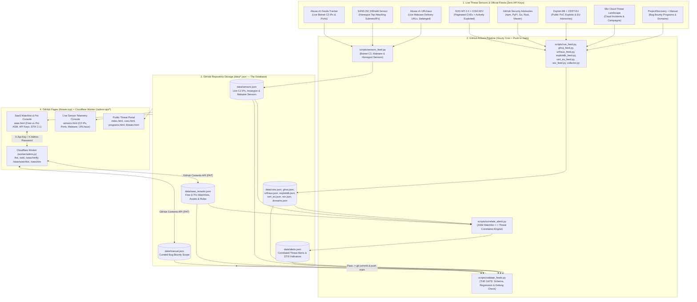

# High-Level & Detailed SaaS Architecture — `threats.top` (`nestho/threats-platform`)

> **Status: historical exploration, superseded.** The first shipped Pro slice is
> live: manual crypto checkout, an audited admin panel, licence keys, and a STIX
> 2.1 export on `api.threats.top`, backed by D1. Read
> [`docs/superpowers/specs/2026-10-28-pro-subscriptions-design.md`](superpowers/specs/2026-10-28-pro-subscriptions-design.md)
> for what was built and [`docs/PAYMENTS.md`](PAYMENTS.md) for the runbook.
> The account system, watchlists, alerting, sensors, and keyed abuse.ch sources
> described below remain unbuilt targets, not production. The legacy Edge Worker
> is retired and returns `410`; the replacement API never writes to git.

**Document ID**: `THREATS-SAAS-ARCH-001`  
**Version**: `2.0.0-Production`  
**Live Domain**: [https://threats.top](https://threats.top)  
**Repository**: `https://github.com/nestho/threats-platform`  
**Core Constraint**: **100% GitHub-Native & Zero-Database Architecture** — No external SQL/NoSQL servers, zero Python third-party runtime dependencies (`requirements.txt` remains empty), automated hourly/weekly GitHub Actions ingestion, Git-committed JSON state (`data/*.json`), and GitHub Pages edge delivery. Phase 2 adds a D1-backed Cloudflare API for accounts, watchlists, Pro enforcement, and OASIS STIX 2.1 exports; the legacy GitHub-writing Worker is retired.

---

## 1. Executive Summary

`threats.top` is an enterprise-grade, open and commercial **Cyber Threat Intelligence (CTI), Live Threat Network Sensor, Bug Bounty Scope, and Attack Surface Monitoring (ASM) SaaS Platform**.

To operate with **zero database maintenance cost** and **100% Git auditability**, the entire platform runs on a **GitHub-as-a-Backend + Cloudflare Edge Worker** architecture:
1. **Local Development & CLI (`scripts/dev.py`)**: Developers build, run live sensor collectors, validate schemas, run the Node & Python test suites, generate cryptographic Free/Pro API keys, and preview the site locally on macOS.
2. **Continuous GitHub Actions Pipeline (`.github/workflows/update-data.yml`)**: When code is pushed to `main` or triggered on the hourly schedule, GitHub Actions runs the 9 Python collectors & correlation engines, validates all outputs through the strict `scripts/validate_feeds.py` regression gate, commits updated `data/*.json` snapshots to `main`, and automatically updates the live GitHub Pages deployment (`threats.top`).
3. **Cloudflare Worker Edge API (`worker/admin.js` on `threats.top/admin-api/*`)**: Handles authenticated writes to GitHub (`data/manual.json` and `data/saas_tenants.json`), verifies cryptographic HMAC-SHA256 `FREE` and `PRO` API keys (`threats_free_...` / `threats_pro_...`), enforces tier limits (Free: 3 watchlist assets vs. Pro: 500 watchlist assets + webhook alerts), and serves on-demand **OASIS STIX 2.1 Threat Intelligence Bundles**.

---

## 2. End-to-End System Topology



---

## 3. Real Threat Sensors Specification (`scripts/sensors_feed.py` → `data/sensors.json`)

To make `threats.top` a true **real-time threat sensor platform** (beyond static vulnerability lists), `scripts/sensors_feed.py` aggregates active attacker infrastructure and malware telemetry from three authoritative sensor networks:

1. **Abuse.ch Feodo Tracker Sensor (`https://feodotracker.abuse.ch/downloads/ipblocklist_recommended.json`)**:
   - Tracks active Botnet Command & Control (C2) servers (`QakBot`, `Pikabot`, `Emotet`, `Dridex`, `TrickBot`, `Bumblebee`).
   - Captures `ip_address`, `port`, `status` (`online`/`offline`), `hostname`, `as_number`, `as_name`, `country`, `first_seen`, `last_online`, and `malware`.
2. **SANS Internet Storm Center (ISC) DShield Honeypot Sensor (`https://isc.sans.edu/api/sources/attacks/100?json` / `topips`)**:
   - Real-time global honeypot and firewall sensor telemetry tracking the most aggressive scanning and exploitation IPv4 sources across the internet.
3. **Abuse.ch URLhaus Payload Sensor (`data/urlhaus.json` cross-enrichment)**:
   - Correlates active malware payload families (`Mirai`, `Mozi`, `LummaStealer`, `RedLine`, `AsyncRAT`, `CobaltStrike`) and defanged distribution endpoints (`hxxp://`, `[.]`).

### `data/sensors.json` Contract (`schema_version: 1`)
| Field | Type | Description |
| :--- | :--- | :--- |
| `schema_version` | `int` | Pin to `1`. Validated by `scripts/validate_feeds.py`. |
| `updated_at` | `iso_datetime` | UTC snapshot timestamp (`YYYY-MM-DDTHH:MM:SSZ`). |
| `total` | `int` | Total active sensor indicators in snapshot. |
| `summary` | `dict` | Breakdown counts by `c2_botnet`, `honeypot_scanner`, `malware_payload`, and top malware families. |
| `items[].id` | `str` | Deterministic indicator ID (e.g., `FEODO-203.0.113.5-443`, `DSHIELD-198.51.100.2`). |
| `items[].sensor` | `enum` | `feodo_c2` \| `dshield_honeypot` \| `urlhaus_payload` |
| `items[].ioc_type` | `enum` | `ipv4` \| `url_defanged` \| `domain` |
| `items[].indicator` | `str` | IPv4 address or defanged URL (`hxxp://...`). Never a live clickable malware URL. |
| `items[].port` | `nullable_int` | Target or C2 port (`443`, `8080`, `2222`, etc.). |
| `items[].malware_family` | `nullable_str` | Malware or botnet family (`Pikabot`, `QakBot`, `Mirai`, `Scanner`, etc.). |
| `items[].severity` | `enum` | `CRITICAL` \| `HIGH` \| `MEDIUM` |
| `items[].confidence` | `int` | Sensor confidence score (`70`–`100`). |
| `items[].country` | `nullable_str` | Two-letter ISO country code if reported by upstream sensor. |
| `items[].asn` | `nullable_str` | Autonomous System Number / Organization if available. |
| `items[].first_seen` | `nullable_iso_datetime` | UTC ISO-8601 timestamp when first observed. |
| `items[].last_seen` | `nullable_iso_datetime` | UTC ISO-8601 timestamp when last observed active. |
| `items[].link` | `url` | Reference link to Abuse.ch or SANS ISC telemetry page. |

---

## 4. SaaS Multi-Tenancy Without a Database (`data/saas_tenants.json` & `data/alerts.json`)

How do we run a production **Free & Pro SaaS** entirely on GitHub + Cloudflare Worker without a database server?

### 4.1 Stateless Cryptographic API Keys (`threats_free_...` & `threats_pro_...`)
Instead of storing session tokens in a database, API keys are **self-contained, HMAC-SHA256 signed tokens** verified at the edge by `worker/admin.js` using a Worker secret (`SAAS_SIGNING_SECRET`, falling back to `ADMIN_PASSWORD_HASH`):
- Format: `threats_<tier>_<tenant_id>_<hmac_signature_hex>`
  - Example Free Key: `threats_free_acme_8f92a1b4c3d2e1f09a8b7c6d`
  - Example Pro Key: `threats_pro_secops_4d3c2b1a0f9e8d7c6b5a4f3e`
- Because the tier (`free` or `pro`) and `tenant_id` are cryptographically bound into the token via HMAC-SHA256, `worker/admin.js` verifies the caller's identity and plan tier in `<1ms` with zero database queries!

### 4.2 Git-Backed Tenant Watchlists (`data/saas_tenants.json`)
- Tenants manage their **Attack Surface Watchlist** (`domains`, `vendors`, `ecosystems/packages`, `ips`, `keywords`) via `/saas.html` -> `worker/admin.js` (`/admin-api/saas/watchlist`) -> committed directly to `data/saas_tenants.json` via the GitHub Contents API (the exact same proven pattern used for `data/manual.json`).
- **Tier Enforcement in Worker (`worker/admin.js`)**:
  - **FREE Tier (`$0 / mo`)**:
    - Up to **3 Watchlist Assets** per tenant (`domains`, `vendors`, or `keywords`).
    - Full access to all public JSON feeds (`/data/*.json`) and browser correlation console.
    - Rate limit: 30 API requests / minute.
  - **PRO Tier (`$39 / mo`)**:
    - Up to **500 Watchlist Assets** per tenant (Domains, Subdomains, CIDR/IPs, Vendor Products, npm/PyPI packages).
    - **Automated GitHub Actions Correlation & Alerting (`data/alerts.json`)**: Every hourly run of `scripts/correlate_alerts.py` scans all 8 live feeds against the tenant's watchlist and publishes matched incidents.
    - **OASIS STIX 2.1 Bundle Export (`/admin-api/saas/stix`)**: Live conversion of matched IOCs, C2 servers, and KEVs into standard STIX 2.1 JSON bundles for Splunk, Microsoft Sentinel, and CrowdStrike.
    - **Outbound Webhook Dispatch**: Optional Slack / Telegram / Signed HTTP Webhook alerts triggered during GitHub Actions correlation runs.

---

## 5. Local Development Workflow (`scripts/dev.py`)

To make local development on macOS fast and effortless while keeping `requirements.txt` empty:

```bash
# 1. Run all unit tests (XSS escaper, source control-byte hygiene, Worker auth + SaaS tier tests)
python3 scripts/dev.py test

# 2. Run live sensor & feed collectors locally and validate against schema contract
python3 scripts/dev.py sync --feed sensors
python3 scripts/dev.py sync --feed correlate
python3 scripts/dev.py validate

# 3. Generate a cryptographic Free or Pro SaaS API key
python3 scripts/dev.py keygen --tenant acme-soc --plan pro

# 4. Serve threats.top locally on http://localhost:8080 (with local /admin-api mock/proxy support)
python3 scripts/dev.py serve --port 8080
```

When you push your changes to `main` (`git push origin main`), GitHub Actions automatically runs:
1. `.github/workflows/validate.yml` (on PRs) to verify all feed contracts and all unit tests.
2. `.github/workflows/update-data.yml` (hourly and via `workflow_dispatch`) to pull fresh sensor telemetry, correlate tenant watchlists, validate against regressions, commit `data/*.json`, and deploy to **[https://threats.top](https://threats.top)**.
