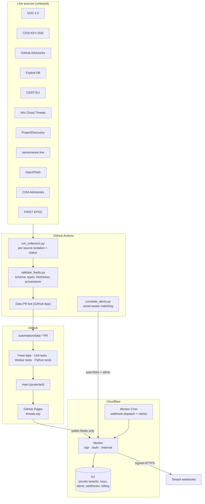

# Real Threats Platform — Design and Delivery Plan

**Date:** 2026-10-27  
**Repository:** `nestho/threats-platform`  
**Status:** Phase 0 and Phase 1 implemented and deployed on 2026-10-28; Phases 2–5 remain  
**Owner:** `nestho`

## Implementation status (2026-10-28)

Landed in production:

- Real unkeyed feeds only; URLhaus, ThreatFox, DShield, Feodo, `sensors.json`, `alerts.json`, and all seeded tenant data removed.
- New collectors for ransomware, phishing, vendor advisories, EPSS, and derived IOCs; cadence-driven `run_collectors.py` with per-source isolation and `status.json`.
- Schema, provenance, freshness, demo-marker, URL-scheme, and status cross-file validation; 98 Python tests and 19 Node tests.
- Pull-request-only `main` with required **Feed data**, **Unit tests**, and **Python tests**, no bypass actors, squash-only history; default Actions token read-only; Pages HTTPS enforced for `threats.top`.
- Automated data delivery through a bot-created `automation/data-*` PR with auto-merge.
- Public pages for vulnerabilities, IOCs, ransomware, phishing, cloud threats, programs, and source status; pricing page is a waitlist because no account system ships yet.

Not landed: D1, GitHub OAuth, Pro tier enforcement, watchlists, correlated alerts, signed webhooks, STIX export, and billing (Phases 2–5). The retired Worker returns `410` and holds no secrets.

---

## 1. Goal

Make `threats.top` a real, trustworthy threat-intelligence product:

- **Real data:** every published record comes from a live source, with visible source health and no fabricated timestamps, seeded tenants, or demo alerts.
- **Always current:** one broken upstream source must not freeze the other feeds; stale data is detected and displayed as stale.
- **Two enforced tiers:** Free and Pro, backed by a private Cloudflare D1 store, not public JSON files.
- **Pro value:** correlated alerts, signed webhooks, and a tenant-scoped STIX 2.1 export.
- **Protected main:** pull-request-only, required checks, no bypass actors, and automation that opens PRs through a GitHub App.
- **Small features:** feed health/freshness, global IOC search, new real feeds, Pro alerts + STIX.

### Success definition

A visitor opens `threats.top` and sees data from the last collection window, a status page that tells the truth about every source, and no demo content. A customer can sign in with GitHub, manage a private watchlist, receive a deduplicated alert through a signed webhook, and export valid STIX. A direct push to `main` is rejected.

---

## 2. Locked decisions

| Decision | Choice | Consequence |
|---|---|---|
| SaaS data store | **Cloudflare D1** | Private tenant data leaves the public repo; the "zero-database" constraint is retired |
| Authentication | **GitHub OAuth** | No email provider; one personal tenant per GitHub user in v1 |
| Billing | **Manual invoices in v1** | Pro is real and enforced, but checkout is manual; Stripe is Phase 5 |
| Alerts | **Signed webhooks only** | No email infrastructure in v1 |
| Main protection | **Strict PR-only + required checks, no bypass** | The data bot must open PRs through a GitHub App |
| abuse.ch | **No Auth-Key; unkeyed feeds only** | URLhaus and ThreatFox are removed; Feodo remains optional/dormant |
| Demo data | **Deleted, not hidden** | No seeded tenants, alerts, or hardcoded plans ship |
| Threat coverage | **Verified unkeyed sources** | NVD, CISA KEV, GHSA, Exploit-DB, CERT-EU, Wiz, ProjectDiscovery, ransomware.live, OpenPhish, CISA advisories, EPSS |

---

## 3. Current state (verified)

1. **Production is frozen at 2026-10-21.** Every scheduled run since then has failed (36/36). `urlhaus.abuse.ch/downloads/csv_recent/` returns `410`, and `update-data.yml` runs collectors under `set -euo pipefail`, so one dead source aborts NVD, GHSA, CERT-EU, Exploit-DB, Wiz, and domains.
2. **The sensor sources are dead or empty.** URLhaus v2 requires an abuse.ch Auth-Key (`urlhaus-api.abuse.ch/v2/files/exports/<KEY>/recent.csv`); ThreatFox export returns `410`; SANS DShield returns `403`; Feodo returns `200` but only 362 bytes (no active C2s).
3. **The SaaS layer is demo data.** `data/saas_tenants.json` seeds `default-pro` and `community-free`; `data/alerts.json` is a 2026-09-27 match set stamped 2026-10-26; `saas.html` hardcodes `PRO` and a 7-asset watchlist. Real tenant watchlists are committed publicly.
4. **`main` is unprotected.** `gh api /repos/nestho/threats-platform/rulesets` returns `[]`; branch protection returns `404`. The data workflow and the Worker both write directly to `main`.
5. **The Worker is not a real SaaS boundary.** Keys are HMAC tokens with the tier embedded; the admin password hash can sign keys; there is no revocation, expiry, or tenant registry; `/add` cannot update existing `manual.json` because it omits the blob SHA.
6. **The validator checks presence and format, not types, freshness, or provenance.** A six-day-stale feed passes.

---

## 4. Target architecture



**Two planes:**

- **Public data plane (GitHub):** collectors, feeds, validation, status, search index, static site. Everything here is public and contains no tenant data.
- **Private SaaS plane (Cloudflare):** GitHub OAuth sessions, tenants, API keys, watchlists, alerts, webhook secrets, subscriptions, audit log. Nothing here is committed to Git.

---

## 5. Public data plane

### 5.1 Feeds

| File | Source | Auth | Cadence | Change |
|---|---|---|---|---|
| `data/cves.json` | NVD 2.0 + CISA KEV | none | 2h | Incremental window from last success; full KEV; EPSS enrichment |
| `data/cves_headline.json` | Derived from `cves.json` | — | 2h | Fix the homepage counter to use the full feed |
| `data/ghsa.json` | GitHub Security Advisories Atom | none | 3h | Keep |
| `data/exploitdb.json` | Exploit-DB RSS | none | 4h | Keep |
| `data/cert_eu.json` | CERT-EU RSS | none | 4h | Keep |
| `data/wiz.json` | Wiz Cloud Threat Landscape RSS | none | weekly | Keep headline + link only; add attribution |
| `data/domains.json` | ProjectDiscovery + `manual.json` | none | 6h | Keep |
| `data/ransomware.json` | ransomware.live v2 recent victims | none | 1h | **New** |
| `data/phishing.json` | OpenPhish public feed (302 → GitHub raw) | none | 1h | **New**, defanged |
| `data/advisories.json` | CISA cybersecurity advisories | none | 4h | **New** |
| `data/epss.json` | FIRST EPSS API (batch ≤100 CVEs) | none | 6h | **New** |
| `data/iocs.json` | Derived: phishing + ransomware victim domains + optional Feodo C2 | — | 1h | **New**, replaces `sensors.json` |
| `data/status.json` | Generated by the collector orchestrator | — | every run | **New** |
| `data/search-index.json` | Generated from all public feeds | — | every run | **New**, compact |
| `data/urlhaus.json` | URLhaus | **key required** | — | **Removed** |
| `data/sensors.json` | Feodo/DShield/URLhaus | mixed | — | **Removed** |
| `data/alerts.json` | Public alerts | — | — | **Removed** (private alerts move to D1) |
| `data/saas_tenants.json` | Public tenants | — | — | **Removed** (tenants move to D1) |

**Optional keyed path:** `ABUSE_CH_AUTH_KEY` remains supported behind an environment flag so URLhaus/ThreatFox/Feodo can be re-enabled later without a code change. It is disabled in v1.

### 5.2 Collector orchestrator

New `scripts/run_collectors.py`:

- Runs each source independently; a failure is recorded, not fatal.
- Uses `scripts/feed_io.py` for atomic writes: fetch and parse fully, validate, then replace the target file. No collector writes an empty or truncated file before exiting.
- Records `last_attempt`, `last_success`, `http_status`, `items`, `error`, `duration_ms` for each source.
- Exits non-zero only when a **critical** source (NVD, CISA KEV) is stale beyond its threshold or a collector produced invalid data.
- Writes `data/status.json` even when some sources fail.

### 5.3 Freshness and provenance rules

`validate_feeds.py` becomes a real gate:

- **Types:** enforce `str`/`int`/`url`/`datetime`/enum, not only key presence.
- **URL safety:** allow only `http:`/`https:`; reject `javascript:`, `data:`, and empty links where a URL is required.
- **Freshness:** `updated_at` must equal the last successful collection time; a feed older than `2 × cadence` (critical: 24h hard limit) is marked stale. Publishing a fresh timestamp over old content is a hard failure.
- **Provenance:** every feed carries `source` and `source_url`; no record may contain `tenant_id`, `plan`, `email`, `api_key`, or watchlist fields.
- **Demo rejection:** the validator and tests reject `default-pro`, `community-free`, and any seeded/example tenant or alert.
- **Completeness:** zero items is a hard failure; NVD `items_parsed == items_available`; duplicate IDs and sort-order violations fail.
- **Cross-file:** `status.json` must agree with each feed's `updated_at` and item count.

### 5.4 Status and outage handling

`data/status.json`:

```json
{
  "schema_version": 1,
  "generated_at": "2026-10-27T20:00:00Z",
  "overall": "degraded",
  "sources": [
    {
      "id": "nvd",
      "label": "NVD",
      "url": "https://services.nvd.nist.gov/rest/json/cves/2.0",
      "cadence_minutes": 120,
      "last_attempt": "2026-10-27T20:00:00Z",
      "last_success": "2026-10-27T18:00:00Z",
      "http_status": 503,
      "items": 3164,
      "error": "HTTP 503",
      "stale": false
    }
  ]
}
```

- The workflow opens or updates **one** GitHub issue (label `data-outage`) when a critical source fails twice in a row, and closes it on recovery.
- The public `/status.html` page and a homepage banner render this file.
- A status-only PR is always allowed to merge so the site can show the outage; a PR containing invalid or fabricated feed data is blocked.

---

## 6. Private SaaS plane (Cloudflare D1)

### 6.1 Schema

`worker/migrations/0001_init.sql`:

```sql
PRAGMA foreign_keys = ON;

CREATE TABLE users (
  id            TEXT PRIMARY KEY,
  github_id     INTEGER UNIQUE NOT NULL,
  login         TEXT NOT NULL,
  email         TEXT,
  avatar_url    TEXT,
  created_at    TEXT NOT NULL,
  last_login_at TEXT NOT NULL
);

CREATE TABLE tenants (
  id            TEXT PRIMARY KEY,
  slug          TEXT UNIQUE NOT NULL,
  name          TEXT NOT NULL,
  owner_user_id TEXT NOT NULL REFERENCES users(id) ON DELETE CASCADE,
  plan          TEXT NOT NULL DEFAULT 'free' CHECK (plan IN ('free','pro')),
  status        TEXT NOT NULL DEFAULT 'active'
                CHECK (status IN ('active','past_due','canceled','requested')),
  created_at    TEXT NOT NULL,
  updated_at    TEXT NOT NULL
);

CREATE TABLE sessions (
  token_hash TEXT PRIMARY KEY,
  user_id    TEXT NOT NULL REFERENCES users(id) ON DELETE CASCADE,
  created_at TEXT NOT NULL,
  expires_at TEXT NOT NULL,
  ip_hash    TEXT,
  user_agent TEXT
);

CREATE TABLE api_keys (
  id           TEXT PRIMARY KEY,
  tenant_id    TEXT NOT NULL REFERENCES tenants(id) ON DELETE CASCADE,
  name         TEXT NOT NULL,
  prefix       TEXT NOT NULL,
  key_hash     TEXT UNIQUE NOT NULL,
  created_by   TEXT NOT NULL REFERENCES users(id),
  created_at   TEXT NOT NULL,
  last_used_at TEXT,
  revoked_at   TEXT
);

CREATE TABLE watchlist_assets (
  id         TEXT PRIMARY KEY,
  tenant_id  TEXT NOT NULL REFERENCES tenants(id) ON DELETE CASCADE,
  type       TEXT NOT NULL CHECK (type IN ('domain','ip','cidr','vendor','package','keyword')),
  value      TEXT NOT NULL,
  normalized TEXT NOT NULL,
  created_at TEXT NOT NULL,
  UNIQUE (tenant_id, type, normalized)
);

CREATE TABLE alerts (
  id          TEXT PRIMARY KEY,
  tenant_id   TEXT NOT NULL REFERENCES tenants(id) ON DELETE CASCADE,
  source      TEXT NOT NULL,
  source_id   TEXT NOT NULL,
  asset_id    TEXT REFERENCES watchlist_assets(id) ON DELETE SET NULL,
  asset_value TEXT NOT NULL,
  indicator   TEXT NOT NULL,
  severity    TEXT NOT NULL,
  confidence  INTEGER NOT NULL,
  title       TEXT NOT NULL,
  url         TEXT NOT NULL,
  first_seen  TEXT NOT NULL,
  last_seen   TEXT NOT NULL,
  payload_json TEXT NOT NULL,
  status      TEXT NOT NULL DEFAULT 'new' CHECK (status IN ('new','acknowledged')),
  created_at  TEXT NOT NULL,
  UNIQUE (tenant_id, source, source_id, asset_value)
);

CREATE TABLE webhooks (
  id          TEXT PRIMARY KEY,
  tenant_id   TEXT NOT NULL REFERENCES tenants(id) ON DELETE CASCADE,
  url         TEXT NOT NULL,
  secret_enc  TEXT NOT NULL,
  events      TEXT NOT NULL,
  active      INTEGER NOT NULL DEFAULT 0,
  verified_at TEXT,
  created_at  TEXT NOT NULL,
  last_error  TEXT
);

CREATE TABLE alert_deliveries (
  id              TEXT PRIMARY KEY,
  alert_id        TEXT NOT NULL REFERENCES alerts(id) ON DELETE CASCADE,
  webhook_id      TEXT NOT NULL REFERENCES webhooks(id) ON DELETE CASCADE,
  status          TEXT NOT NULL DEFAULT 'pending'
                  CHECK (status IN ('pending','delivered','failed')),
  attempts        INTEGER NOT NULL DEFAULT 0,
  next_attempt_at TEXT NOT NULL,
  last_error      TEXT,
  created_at      TEXT NOT NULL,
  UNIQUE (alert_id, webhook_id)
);

CREATE TABLE subscriptions (
  tenant_id                TEXT PRIMARY KEY REFERENCES tenants(id) ON DELETE CASCADE,
  plan                     TEXT NOT NULL CHECK (plan IN ('free','pro')),
  status                   TEXT NOT NULL
                           CHECK (status IN ('active','past_due','canceled','requested')),
  invoice_ref              TEXT,
  started_at               TEXT,
  renews_at                TEXT,
  notes                    TEXT,
  provider                 TEXT NOT NULL DEFAULT 'manual',
  provider_customer_id     TEXT,
  provider_subscription_id TEXT,
  updated_at               TEXT NOT NULL
);

CREATE TABLE pro_requests (
  id          TEXT PRIMARY KEY,
  tenant_id   TEXT NOT NULL REFERENCES tenants(id) ON DELETE CASCADE,
  note        TEXT,
  status      TEXT NOT NULL DEFAULT 'requested'
              CHECK (status IN ('requested','invoiced','activated','declined')),
  created_at  TEXT NOT NULL,
  resolved_at TEXT
);

CREATE TABLE rate_limits (
  subject TEXT NOT NULL,
  bucket  INTEGER NOT NULL,
  count   INTEGER NOT NULL,
  PRIMARY KEY (subject, bucket)
);

CREATE TABLE audit_log (
  id            TEXT PRIMARY KEY,
  tenant_id     TEXT REFERENCES tenants(id) ON DELETE SET NULL,
  actor_user_id TEXT,
  action        TEXT NOT NULL,
  metadata_json TEXT,
  created_at    TEXT NOT NULL
);

CREATE INDEX idx_alerts_tenant_created ON alerts (tenant_id, created_at DESC);
CREATE INDEX idx_alerts_tenant_status  ON alerts (tenant_id, status);
CREATE INDEX idx_watchlist_tenant      ON watchlist_assets (tenant_id);
CREATE INDEX idx_deliveries_due        ON alert_deliveries (status, next_attempt_at);
CREATE INDEX idx_sessions_expiry       ON sessions (expires_at);
CREATE INDEX idx_rate_limits_bucket    ON rate_limits (bucket);
```

**No seed data.** A fresh D1 database contains zero users, tenants, and alerts.

### 6.2 Retention

- Alerts: 90 days, pruned by the dispatcher cron.
- Deliveries: 30 days after terminal state.
- Rate-limit buckets: 24 hours.
- Audit log: 1 year.
- Deleted tenants: cascade-deleted; audit rows retained with `tenant_id = NULL`.

---

## 7. Authentication, tenants, and API keys

### 7.1 GitHub OAuth

- Routes: `GET /auth/github` → GitHub authorize; `GET /auth/callback` → exchange code, fetch `/user` and `/user/emails`, upsert `users`, create the user's Free tenant on first login.
- Scopes: `read:user user:email`.
- State: 32-byte random value in a short-lived HttpOnly cookie; constant-time compare on callback.
- Session: 32-byte random bearer in an HttpOnly, Secure, SameSite=Lax cookie; only SHA-256(token) is stored; 30-day TTL; logout deletes the row.
- CSRF: SameSite=Lax plus an `Origin` allowlist check on every state-changing request.
- Admin: GitHub numeric IDs listed in `ADMIN_GITHUB_IDS`. Admin routes are session-authenticated and audit-logged. No shared admin password.

### 7.2 API keys

- Format: `threats_<32-byte-base64url>`; the key carries **no plan or tenant claim**.
- Storage: SHA-256 hash plus a 12-character display prefix. The plaintext is returned once at creation.
- Lookup: hash the presented key, fetch the key + tenant from D1. **Plan comes from the tenant record**, so upgrades/downgrades take effect immediately.
- Lifecycle: create, list (prefix only), revoke; rotation = create new then revoke old; `last_used_at` updated at most once per minute.
- Rate limits: Free 30 requests/min, Pro 600 requests/min per key/tenant, enforced with the `rate_limits` table and a minute bucket.
- A leaked key is revocable without rotating anything global.

### 7.3 Webhook secrets

- 32-byte random secret, returned once; stored encrypted at rest with AES-GCM using `WEBHOOK_ENCRYPTION_KEY`. The stored value is `base64url(iv).base64url(ciphertext)`.
- Signature: `X-Threats-Signature: t=<unix>,v1=<hex HMAC-SHA256(secret, t + "." + body)>`.
- Only verified endpoints receive deliveries (`verified_at` set after a signed verification handshake).

---

## 8. Free vs Pro

| Capability | Free | Pro (proposed $39/mo, manual invoice) |
|---|---|---|
| Public feeds and public pages | Yes | Yes |
| GitHub account + private watchlist | Yes | Yes |
| Watchlist assets | 3 | 500 |
| API rate limit | 30/min | 600/min |
| Correlated alerts | No | Yes |
| Signed webhooks | No | Yes |
| STIX 2.1 export | No | Yes |
| Alert retention | — | 90 days |
| Support | Community | Email/issue priority |

Entitlements are enforced **server-side** in every handler. The client only renders what the API returns.

**Upgrade flow (v1, manual):** the console shows a "Request Pro" form → `pro_requests` row → admin sees it in the admin panel, issues an invoice, records it in `subscriptions`, sets `tenants.plan = 'pro'`, and notifies the user. No Stripe in v1.

---

## 9. Worker API surface

All routes are same-origin on `threats.top`; `/api/*`, `/auth/*`, and `/internal/*` route to the Worker, everything else to Pages.

| Method | Route | Auth | Notes |
|---|---|---|---|
| GET | `/health` | none | Minimal liveness JSON, no secrets |
| GET | `/auth/github` | none | Start OAuth |
| GET | `/auth/callback` | OAuth state | Create session |
| POST | `/auth/logout` | session | Delete session |
| GET | `/api/me` | session or key | User, tenant, plan, usage |
| GET | `/api/me/export` | session | JSON export of the account's data |
| DELETE | `/api/me` | session | Delete the user, tenant, keys, watchlist, alerts, and webhooks |
| GET | `/api/watchlist` | session or key | Tenant-scoped |
| POST | `/api/watchlist` | session or key | Quota enforced |
| DELETE | `/api/watchlist/:id` | session or key | Tenant-scoped |
| GET | `/api/alerts` | session or key | Pagination, filters, tenant-scoped |
| POST | `/api/alerts/:id/ack` | session or key | Tenant-scoped |
| GET | `/api/export/stix` | session or key, Pro | Valid STIX 2.1 bundle |
| GET | `/api/webhooks` | session or key, Pro | Prefix/metadata only |
| POST | `/api/webhooks` | session or key, Pro | Secret returned once |
| DELETE | `/api/webhooks/:id` | session or key, Pro | Tenant-scoped |
| POST | `/api/pro/request` | session | Creates `pro_requests` row |
| GET | `/api/admin/tenants` | admin session | List tenants |
| POST | `/api/admin/keys` | admin session | Issue key, plaintext once |
| POST | `/api/admin/keys/:id/revoke` | admin session | Revoke |
| POST | `/api/admin/subscriptions` | admin session | Set plan/invoice/renewal |
| GET | `/internal/watchlists` | internal token | Actions only; no PII |
| POST | `/internal/alerts` | internal token | Upsert alerts and queue deliveries |

Security controls on every route:

- Tenant ID is derived from the session/key, never from the request body.
- Cross-tenant lookups return `404`.
- JSON only; `Content-Type` checked; body size caps per route.
- `Origin` allowlist: `https://threats.top` and localhost dev.
- Security headers: `Content-Security-Policy`, `Strict-Transport-Security`, `X-Content-Type-Options`, `Referrer-Policy`, `Permissions-Policy`.
- Errors are generic; upstream bodies and secrets never reach the client.
- Admin and internal actions are audit-logged.

---

## 10. Correlation and alerts

`scripts/correlate_alerts.py` is rewritten:

1. `GET /internal/watchlists` from the Worker (internal token) → tenants, plans, assets.
2. Read all public feeds from the working tree.
3. Match by asset type:
   - `domain`: exact or subdomain-boundary match (not substring); punycode-normalized.
   - `ip` / `cidr`: `ipaddress` containment.
   - `vendor`: word-boundary match against vendor/product fields.
   - `package`: exact ecosystem/name match.
   - `keyword`: bounded match in title/summary.
4. Scan the full CVE window (no 400-item cap), KEV, GHSA, Exploit-DB, CERT-EU, Wiz, ransomware, phishing, advisories, and IOCs.
5. Emit one alert per `(tenant, source, source_id, asset)`; the Worker upserts by that unique key, sets `first_seen` once, and updates `last_seen`. **No hourly re-alerting.**
6. `POST /internal/alerts` in batches; the Worker validates tenant IDs, inserts alerts, and queues deliveries.
7. Per-tenant cap: 1,000 active alerts; oldest acknowledged alerts pruned first. Global run cap: 10,000 alerts.

Correlation runs after collection in the same workflow and can be triggered manually. A correlation failure opens/updates the outage issue but does not block the public data PR.

---

## 11. Webhook delivery

- Worker Cron every 5 minutes selects due `alert_deliveries`.
- URL rules: HTTPS only, no userinfo, no redirects, no localhost/private/link-local/metadata addresses; endpoint must be verified.
- Payload:

```json
{
  "event": "alert.created",
  "delivery_id": "dlv_...",
  "tenant": "acme-soc",
  "alert": {
    "id": "ALT-...",
    "source": "cisa_kev",
    "indicator": "CVE-2026-102764",
    "asset": "ivanti",
    "severity": "CRITICAL",
    "confidence": 95,
    "title": "CISA KEV: ...",
    "first_seen": "2026-10-27T18:00:00Z"
  }
}
```

- Retries: 5 attempts with exponential backoff over 24 hours; then `failed`, endpoint `last_error` set.
- A webhook that fails 20 consecutive deliveries is disabled and the tenant is notified in the console.
- Slack/Teams adapters are payload transforms, not separate transports.

---

## 12. STIX 2.1 export

- Tenant-scoped; only alerts and indicators belonging to the caller.
- Valid UUIDv4 IDs (`crypto.randomUUID`), `spec_version: "2.1"`.
- Objects: `identity` (threats.top), `indicator` (URL/domain/IP), `vulnerability` (CVE), `malware` (ransomware family), `relationship` where meaningful.
- TLP:CLEAR marking on every object.
- URLs are rehydrated from defanged form only inside `pattern` values; patterns are escaped correctly and never rendered as clickable links.
- Tests validate the bundle with the Python `stix2` library (dev dependency) and assert no cross-tenant objects.

---

## 13. Frontend

### 13.1 Public pages

| Page | Content |
|---|---|
| `index.html` | Latest threats across all feeds; status banner; top EPSS; ransomware and phishing highlights; corrected counters |
| `cves.html` | Full CVE window, KEV tab, EPSS sort/filter |
| `iocs.html` | Unified IOC feed (phishing URLs, ransomware victim domains, optional C2), defanged, source labels |
| `ransomware.html` | Victim claims, group, sector, country, timeline |
| `phishing.html` | OpenPhish feed, defanged, searchable |
| `threats.html` | Cloud threats (Wiz) + CISA advisories, tabs |
| `programs.html` | Bug-bounty programs (unchanged) |
| `status.html` | Per-source health, last success, item counts, stale badges |
| `search.html` | Global IOC search over `data/search-index.json` |
| `saas.html` | Pricing and login CTA only; no demo console |
| `app.html` | Authenticated console: overview, watchlist, alerts, keys, webhooks, STIX, plan, admin |

Every page has explicit loading, empty, error, and stale states. No page claims freshness without `status.json` evidence.

### 13.2 Global search

- `scripts/build_search_index.py` builds `data/search-index.json` from public feeds.
- Entry: `{id, type, title, indicators[], url, date, severity, source}`.
- Cap: 5,000 entries / 2 MB, prioritized by recency, KEV, and severity.
- `search.html` loads the index once, filters in memory, and deep-links to the owning page.
- Search is public and never queries tenant data.

### 13.3 Shared assets

- `assets/app.js` keeps `esc()`, `timeAgo`, fetch helpers.
- New `assets/api.js` handles credentialed `/api/*` calls and error states.
- `assets/search.js` for the search page.
- Remove duplicate inline header/nav markup where practical; keep the change scoped.
- Add a CSP meta tag to every page; no third-party scripts.

---

## 14. Main branch protection and release process

### 14.1 Ruleset

`scripts/setup-ruleset.sh` is rewritten to apply:

```json
{
  "name": "protect-main",
  "target": "branch",
  "enforcement": "active",
  "bypass_actors": [],
  "conditions": { "ref_name": { "include": ["~DEFAULT_BRANCH"], "exclude": [] } },
  "rules": [
    { "type": "deletion" },
    { "type": "non_fast_forward" },
    {
      "type": "pull_request",
      "parameters": {
        "required_approving_review_count": 0,
        "dismiss_stale_reviews_on_push": true,
        "require_code_owner_review": false,
        "require_last_push_approval": false,
        "required_review_thread_resolution": true,
        "allowed_merge_methods": ["squash"]
      }
    },
    {
      "type": "required_status_checks",
      "parameters": {
        "strict_required_status_checks_policy": false,
        "required_status_checks": [
          { "context": "Feed data" },
          { "context": "Unit tests" },
          { "context": "Worker tests" },
          { "context": "Python tests" }
        ]
      }
    }
  ]
}
```

`required_approving_review_count: 0` because this is a single-owner repository; the PR requirement still blocks every direct push. If a second maintainer is added, raise it to 1.

### 14.2 Repository settings

```bash
gh api -X PATCH repos/nestho/threats-platform \
  -f allow_auto_merge=true \
  -f allow_squash_merge=true \
  -f allow_merge_commit=false \
  -f allow_rebase_merge=false \
  -f delete_branch_on_merge=true

gh api -X PUT repos/nestho/threats-platform/actions/permissions/workflow \
  -f default_workflow_permissions=read \
  -F can_approve_pull_request_reviews=false
```

Enable secret scanning, push protection, Dependabot alerts, and CodeQL (public repository).

### 14.3 Data bot (GitHub App)

- App `threats-data-bot`: `Contents: read/write`, `Pull requests: read/write`, `Metadata: read`.
- Installed on this repository; `APP_ID` and `APP_PRIVATE_KEY` stored as Actions secrets.
- The workflow uses `actions/create-github-app-token` (SHA-pinned) to mint a short-lived installation token; no long-lived PAT.
- Workflow:
  1. Run collectors and validation.
  2. If `data/` changed, create `automation/data-<UTC>` and commit.
  3. Create a PR with a short summary (sources updated, counts, stale flags).
  4. Enable auto-merge (squash).
  5. Required checks run on the PR; the PR merges only when they pass.
- No bypass actors. The app cannot push to `main`; it can only push its own branch and open a PR.
- If nothing changed, no PR is created.

### 14.4 Human release flow

1. Branch from `main`: `feat/...`, `fix/...`, or `docs/...`.
2. Open a PR using the template (what changed, tests, contract impact, no-demo check).
3. Required checks pass.
4. Squash merge; branch deleted automatically.
5. Pages deploys from `main`.

### 14.5 Worker deployment

- Deploy manually with `wrangler deploy` (or a protected `workflow_dispatch` workflow with an environment approval).
- D1 migrations applied before Worker deployment.
- The Worker no longer writes to GitHub, so `GITHUB_TOKEN` is removed from its secrets.

---

## 15. Security and privacy

- **No private data in Git.** Tenant IDs, emails, watchlists, alerts, keys, webhook secrets, invoices, and audit logs live only in D1.
- **No demo data anywhere.** Tests grep for seed markers and fail.
- **Key hashing and revocation.** Random keys, SHA-256 at rest, per-key revocation, plan from the tenant record.
- **Tenant isolation.** Every query includes `tenant_id` from the authenticated principal; cross-tenant IDs return 404.
- **SSRF protection.** HTTPS-only, no redirects, private-range blocking, endpoint verification.
- **XSS.** Keep the single `esc()` path; add a CSP; validate URL schemes; no `innerHTML` with unescaped feed data.
- **Secrets.** `WEBHOOK_ENCRYPTION_KEY`, `INTERNAL_TOKEN`, `GITHUB_OAUTH_CLIENT_SECRET`, `APP_PRIVATE_KEY`. Session and OAuth-state tokens are random and stored hashed; they are not signed with a separate secret. All secrets are Worker/Actions secrets, never in Git.
- **Admin.** GitHub ID allowlist, session auth, audit log; no shared password.
- **Privacy policy.** Document what is public (feeds, status, search) vs private (account, watchlist, alerts), retention, export, and account deletion.
- **Attribution.** Add `NOTICE` and a footer crediting NVD, CISA, GitHub, Exploit-DB, CERT-EU, Wiz, ProjectDiscovery, ransomware.live, OpenPhish, and FIRST EPSS. Wiz content is headline + link only.
- **Incident response.** Rotate the affected secret, revoke API keys/webhooks, disable the Worker route, restore D1 from Time Travel/export, publish a status note.

---

## 16. Testing and CI

### 16.1 Python (stdlib `unittest`, fixture-based, no network)

- `normalize.py` self-check (existing).
- `feed_io.py` atomic write and failure behavior.
- Each collector parses a recorded fixture and emits the contract; malformed/empty fixtures fail.
- `run_collectors.py`: one source fails, others still publish; critical staleness exits non-zero; status.json is correct.
- `validate_feeds.py`: types, URL schemes, freshness, duplicate IDs, provenance, demo rejection.
- `correlate_alerts.py`: domain boundary, CIDR containment, package exact match, vendor word boundary, dedupe, caps.
- `build_search_index.py`: size cap, required fields, no private fields.

### 16.2 Worker (Vitest + `@cloudflare/vitest-pool-workers`, real local D1)

- OAuth state and callback; failed state rejected.
- Session creation, expiry, logout.
- API key create/list/revoke; revoked key rejected; plan changes take effect.
- Tenant isolation on watchlist, alerts, webhooks, STIX.
- Free 3 / Pro 500 quotas; Free cannot access Pro endpoints.
- Rate limits per plan.
- Internal token required; PII never returned.
- STIX bundle validity and no cross-tenant objects.
- Webhook signing, retry state, SSRF rejection.
- Security headers, CORS, body-size caps, error redaction.

- Add `requirements-dev.txt` with `stix2` for bundle validation. Runtime dependencies remain zero; `requirements.txt` stays empty.

### 16.3 CI jobs

| Job name | Runs |
|---|---|
| `Feed data` | normalize + `validate_feeds.py --against <base>` |
| `Unit tests` | `node --test assets` |
| `Worker tests` | `npm ci && npm run test:worker` |
| `Python tests` | `python3 -m unittest discover -s tests` |
| `CodeQL` | JS/Python analysis (not required initially) |

All jobs run on every PR to `main`. Required checks: the first four.

---

## 17. Delivery plan

### Phase 0 — Stabilize data and remove demo (P0)

**Files:** `scripts/run_collectors.py`, `scripts/feed_io.py`, `scripts/status.py`, `scripts/cve_feed.py`, `scripts/ransomware_feed.py`, `scripts/phishing_feed.py`, `scripts/cisa_advisories_feed.py`, `scripts/epss_feed.py`, `scripts/iocs_feed.py`, `scripts/validate_feeds.py`, `.github/workflows/update-data.yml`, `data/*.json`, `index.html`, `cves.html`, `threats.html`, `docs/CONTRACT.md`, `tests/`.

- Disable the failing schedule.
- Implement per-source isolation, atomic writes, status, freshness.
- Add ransomware.live, OpenPhish, CISA advisories, EPSS; full KEV; incremental NVD (last success, max 120-day window); fix the weekly Wiz selector.
- Remove URLhaus, ThreatFox, DShield, Feodo and `sensors.json`.
- Delete `data/alerts.json`, `data/saas_tenants.json`, and all demo UI.
- Fix homepage counters and empty/error/stale states.
- Merge via PR.

**Acceptance:** `data/status.json` shows every source with a real last success; no feed is older than 2× cadence; `grep -R "default-pro\|community-free" data/ *.html` is empty; Python tests pass.

### Phase 1 — Protect main

**Files:** `.github/workflows/update-data.yml`, `.github/workflows/validate.yml`, `scripts/setup-ruleset.sh`, `.github/pull_request_template.md`, `SECURITY.md`, docs.

- Create the GitHub App and store secrets.
- Convert the data workflow to branch + PR + auto-merge.
- Add the new CI jobs.
- Apply the ruleset and repository settings. Apply it in two steps: first PR-only with `Feed data` + `Unit tests`, then add `Worker tests` and `Python tests` as those jobs land. Never require a check that does not exist yet.
- Re-enable the schedule; verify the first bot PR auto-merges.

**Acceptance:** `git push origin main` is rejected; a bot PR merges only after all required checks; `gh api .../rulesets` shows `bypass_actors: []`.

### Phase 2 — Private SaaS core

**Files:** `worker/migrations/0001_init.sql`, `worker/src/*`, `worker/wrangler.toml`, `app.html`, `saas.html`, `assets/api.js`, `worker/test/*`, `package.json`.

- Create D1; apply migrations.
- Implement GitHub OAuth, sessions, tenants, keys, watchlist, admin.
- Deploy the Worker to `/api/*` and `/auth/*`.
- Remove the public tenant/alerts files and the demo console.

**Acceptance:** GitHub login creates a Free tenant; 3-asset quota; keys are hashed and revocable; a cross-tenant request returns 404; no private data in any public feed.

### Phase 3 — Alerts, webhooks, STIX

**Files:** `scripts/correlate_alerts.py`, `worker/src/internal.js`, `worker/src/alerts.js`, `worker/src/webhooks.js`, `worker/src/stix.js`, tests.

- Rewrite matching and dedupe.
- Add internal watchlist/alert endpoints.
- Implement signed webhook delivery and retries.
- Implement tenant-scoped STIX 2.1.
- Enforce Pro entitlements.

**Acceptance:** one watchlist match produces one alert (not hourly duplicates); a signed webhook verifies; the STIX bundle validates and contains no other tenant's data.

### Phase 4 — Public UX and features

**Files:** `status.html`, `search.html`, `ransomware.html`, `phishing.html`, `iocs.html`, `assets/search.js`, `scripts/build_search_index.py`, `index.html`, `cves.html`, `NOTICE`, `docs/OPERATIONS.md`, `docs/PRIVACY.md`, `README.md`, `ARCHITECTURE.md`, `CONSTRAINTS.md`, `docs/CONTRACT.md`.

- Status page and homepage banner.
- Global IOC search.
- Ransomware, phishing, and advisory pages.
- EPSS sorting and KEV view.
- Attribution, README, architecture, contract, operations, privacy docs.

**Acceptance:** search returns results across all feeds; status reflects a simulated source failure; no demo content; all pages have empty/error/stale states.

### Phase 5 — Billing (later)

- Stripe Checkout, webhook, Customer Portal.
- Reuse the existing `subscriptions` table (`provider`, provider IDs).
- Keep manual invoices as an admin fallback.

**Not in v1:** Stripe, email alerts, team memberships, SSO, mobile app, malware sample storage, abuse.ch keyed feeds.

---

## 18. Manual setup checklist

These require the repository or Cloudflare account owner and cannot be fully automated:

1. **GitHub App** `threats-data-bot` with contents and pull-request write; install on the repo; store `APP_ID` and `APP_PRIVATE_KEY`.
2. **GitHub OAuth App** with callback `https://threats.top/auth/callback`; store `GITHUB_OAUTH_CLIENT_ID` and `GITHUB_OAUTH_CLIENT_SECRET`.
3. **Cloudflare D1**: `wrangler d1 create threats-platform`; add `database_id` to `wrangler.toml`; apply migrations.
4. **Worker secrets**: `WEBHOOK_ENCRYPTION_KEY`, `INTERNAL_TOKEN`, `ADMIN_GITHUB_IDS`, OAuth secrets.
5. **Worker routes**: `/api/*`, `/auth/*`, `/internal/*` → Worker; keep Pages for static content.
6. **Cutover check**: compare the in-repo Worker with the live dashboard Worker before deploying; the repo copy is documented as a reconstruction.
7. **Repository settings**: auto-merge, squash-only, delete branch on merge, read-only default workflow token, no workflow PR approvals.
8. **Optional later**: abuse.ch Auth-Key, Stripe account.

---

## 19. Risks and mitigations

| Risk | Mitigation |
|---|---|
| Manual invoicing limits growth | Tier enforcement is real; Stripe is isolated to Phase 5 and reuses the subscription table |
| GitHub OAuth excludes non-GitHub customers | Acceptable for v1; email magic link is a later auth adapter |
| D1 free-tier daily limits | Small tenant count; monitor usage; upgrade to Workers Paid ($5/mo) if needed |
| Worker CPU limit for STIX/alerts | Paginate queries; cap bundle size; move heavy matching to Actions |
| Wiz/ransomware.live/OpenPhish terms | Headline + link only for Wiz; attribution and NOTICE; disable if terms change |
| Live Worker may differ from the repo | Backup/compare before cutover; deploy during a maintenance window |
| GitHub App private key compromise | Actions secret only; rotate immediately; audit log |
| Hourly data PR churn | One PR per changed window; auto-merge; no PR when nothing changed |
| Owner can still edit the ruleset | No bypass actors; changes to the ruleset are visible in the GitHub audit log |
| Search index size | 5,000-entry / 2 MB cap; prioritize recent and high-severity items |
| CISA advisories XML is large | Parse once, keep the latest 100; timeout and status recorded |

---

## 20. Open items to close during implementation

- Choose the repository license (code vs data). Not required for the platform to work, but required before advertising open data reuse.
- Confirm the live Worker deployment path and back up the dashboard version.
- Confirm the GitHub OAuth App owner and callback domain.
- Decide whether the `$39/mo` Pro price stays for manual invoices.
- Decide whether Wiz content stays at headline + link or is removed entirely.

---

## 21. What "done" looks like

- `https://threats.top/status.html` shows every source healthy, with `last_success` inside its cadence, for seven consecutive days.
- No public file contains `default-pro`, `community-free`, or a fabricated `updated_at`.
- A direct push to `main` fails; every change arrives through a PR that passed `Feed data`, `Unit tests`, `Worker tests`, and `Python tests`.
- A new user signs in with GitHub, manages three assets on Free, requests Pro, and (after an invoice) manages 500, receives a signed webhook, and exports a valid STIX bundle.
- The admin can revoke a key in one click, and the key stops working immediately.
